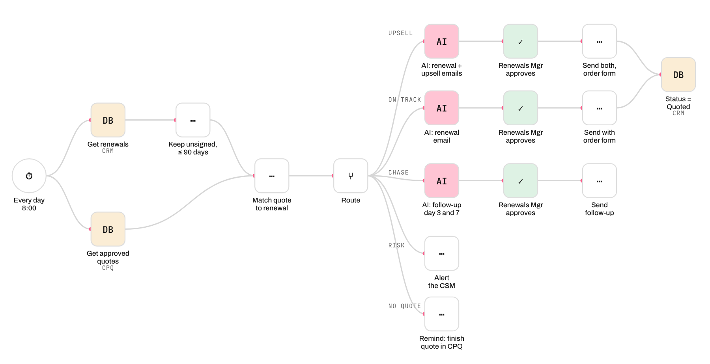

# Part 3: From approved quote to signature, every morning

I extended my own n8n workflow, *Daily renewal alerts*, which I built before this challenge. It now covers the part of the renewal that eats the most time once a quote exists: emailing the customer, sending the order form, updating the CRM and chasing the signature. At 221 renewals a quarter, this is where days slip.

Pink AI steps draft the email · green ✓ steps wait for a person's approval · DB steps read from or write to the CRM and CPQ.

**What it does, step by step**

1. **Every morning at 8:00** it reads the renewals due within 90 days that aren't signed yet, and pulls the quotes already **approved in the CPQ**.
2. **It matches each renewal to its approved quote**, so every email uses the exact offer, order form and quote number the customer will sign.
3. **It routes each renewal to one of five paths:**
   - **On track:** AI drafts the renewal email around the approved offer → I approve it → it goes out with the order form for e-signature.
   - **Upsell** (usage above the plan): AI drafts the renewal email and a separate upsell email → I approve both → both go out.
   - **Chase signature:** 3 and 7 days after sending, if it isn't signed, AI drafts a short follow-up → I approve → it goes out.
   - **Risk** (red health, usage dropping): no customer email. The CSM gets an alert to act first.
   - **No quote yet:** I get a reminder to finish the quote in the CPQ before the deadline slips.
4. **Nothing reaches a customer without my click.** Each draft arrives in my inbox with Approve and Reject buttons (Gmail send-and-wait), and the workflow waits.
5. **After sending, it writes back to the CRM:** status *Quoted* and the date sent. That date starts the signature chase.

**Why this design:** the numbers come from the approved quote, never from the AI, and a person approves everything that reaches a customer. AI does the writing, where it saves the most time. **How I'd know it works:** quote out by day 60, 1 of 7 → **100%** · approved quote to sent: **same day** · signed within 7 days: tracked · AI drafts approved without edits: tracked. **Tested** on five accounts, one per path, with no real emails sent. The prototype uses Google Sheet tabs in place of Salesforce and the CPQ, and the workflow JSON is attached.

