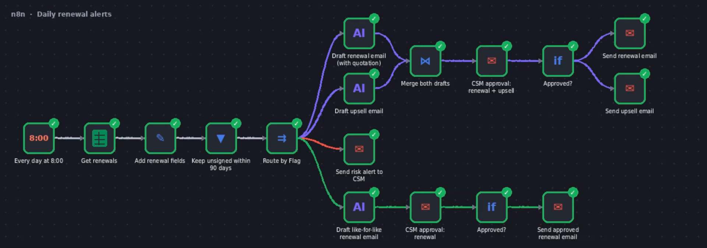

# Part 3: Daily renewal alerts, my own n8n workflow

<b>Note:</b> I built this workflow on 13 October for my first recruiter call, before I received this case. It runs on sample accounts, not the ten in the brief, so names, dates and amounts differ, and a Google Sheet stands in for the CRM. The logic is what I'd run on this book. <b>Video walkthrough (78 seconds): <code>renewal_alerts_n8n_walkthrough.mp4</code></b>, attached.

**The repetitive step:** every morning, someone has to check which renewals need action, write the renewal email with the quotation, and flag the risky accounts. At 221 renewals a quarter, this is where quotes go out late: in this book, only 1 of 7 manual renewals had its quote out by day 60.

**What triggers it:** a schedule, every day at 8:00. Nobody has to remember to check the renewals list.

**Systems it touches:** the renewals sheet (standing in for Salesforce: renewal date, ARR, status, usage flag) · OpenAI (GPT-5 mini, for drafting only) · Gmail (send-and-wait approval, then send).

**What it does, step by step**

1. **Reads every renewal** and adds the days to renewal and the window (30, 60 or 90 days).
2. **Keeps only what needs action:** unsigned renewals within 90 days. Signed contracts and later renewals drop out.
3. **Routes each renewal by its usage flag:**
   - **Like-for-like:** AI drafts the renewal email with the quotation → the CSM approves → it's sent.
   - **Upsell** (usage above the plan): AI drafts the renewal email with the quotation, plus a separate upsell email → the CSM approves both → both are sent.
   - **Risk** (usage dropping): no AI and no customer email. The account owner gets an alert to review the account before any outreach.

**What a human still checks:** every customer email waits in Gmail with Approve and Reject buttons until a person clicks. The AI has fixed rules: no discounts and no price talk. Amounts come from the sheet, never from the model. Risk accounts never get an automatic email.

**How I'd know it works:** quote out by day 60, from 1 of 7 → **100%** · days from alert to email sent · renewals signed before their renewal date · AI drafts approved without edits (once that's consistently high, standard renewals can go out without the click).

**For this book, what I'd add next** (not built): attach the approved CPQ quote and order form instead of writing the quotation in the email, chase unsigned order forms on days 3 and 7, and write the status back to the CRM (*Quoted*, date sent).

